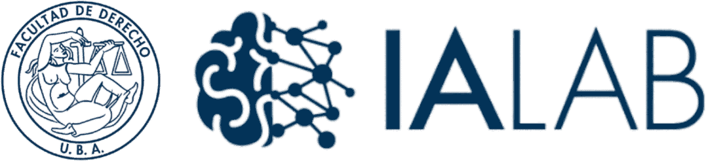
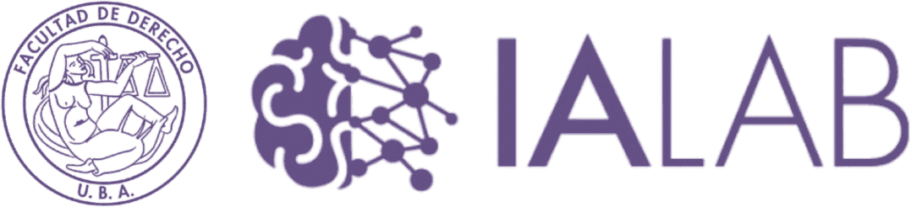
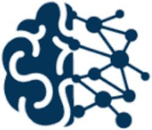

# Brand Guideliness - UBA IALAB

**Brand Guideliness - UBA IALAB**

Laboratorio de Innovación e Inteligencia Artificial - Facultad de Derecho, UBA

---

## Instrucciones obligatorias para cualquier IA

### Principios generales

- Priorizar claridad sobre cantidad de información.
- Cada slide comunica una sola idea principal; si contiene más de una, se divide.
- Reducir el texto al mínimo indispensable.
- Mantener un registro académico, institucional y profesional en todo momento.
- No utilizar lenguaje promocional, grandilocuente o marketinero.

### Reglas de contenido

- Eliminar frases introductorias innecesarias.
- Eliminar conclusiones redundantes.
- Eliminar aclaraciones obvias.
- Eliminar repeticiones conceptuales entre slides.
- No usar párrafos extensos; preferir títulos breves, cifras grandes, diagramas simples y esquemas conceptuales.

### Reglas de redacción

- No utilizar emojis en ninguna pieza institucional.
- Utilizar lenguaje descriptivo y verificable; toda cifra debe ser trazable a una fuente.
- Eliminar el símbolo "≈" delante de los números.

---

## 1. Logo

### Versiones disponibles

**Versión primaria — fondo claro**

**Versión monocromática — impresión a una tinta**

**Versión reverso — uso exclusivo sobre fondos oscuros**

**Variante secundaria — uso restringido, no institucional**

### Isotype

El isotype (la red neuronal sobre la balanza estilizada) puede usarse de forma aislada en favicons, marcas de agua, redes sociales o como elemento decorativo, siempre en una de las cuatro versiones de color aprobadas.

### Clear space

El área de resguardo mínima alrededor del logo equivale a la altura de la "I" de IALAB (x), medida desde el isotype, replicada en los cuatro costados de la composición. Ningún elemento gráfico, texto o borde de slide puede ingresar a esa zona.

Para el isotype usado de forma aislada, el área de resguardo equivale a medio módulo (x/2) en los cuatro lados, tomando como referencia el ancho del isotype.

### Tamaño mínimo

En presentaciones y documentos digitales, el imagotype completo (escudo UBA + isotype + wordmark) no debe reproducirse por debajo de 120 px de ancho equivalente, ni de 2,5 cm en piezas impresas. Por debajo de ese umbral se pierde la legibilidad de la red de nodos del isotype.

### Colocación por defecto

En slides, el imagotype se ubica en la esquina superior derecha respetando el clear space definido. En portadas y separadores de sección, el logo puede centrarse o ubicarse según el arquetipo correspondiente (sección 5).

### Usos no permitidos

- Estirar, comprimir o distorsionar las proporciones del logo.
- Alterar los colores fuera de las cuatro versiones aprobadas.
- Aplicar el logo sobre fondos fotográficos de alto ruido visual sin un recuadro de contraste.
- Rotar el logo o aplicar efectos (sombra, relieve, gradientes, contornos).
- Separar el isotype del wordmark dentro de una misma pieza, salvo en los usos aislados descritos arriba.

---

## 2. Paleta de colores

| Token | HEX | RGB | Uso principal |
|---|---|---|---|
| **primary-500** | #051431 | 5, 20, 49 | Logo, títulos, fondos institucionales |
| **accent-400** | #7D539D | 125, 83, 157 | Destacados, CTAs, variante secundaria |
| **secondary-700** | #203958 | 32, 57, 88 | Subtítulos, elementos de apoyo |
| **text-primary** | #141414 | 20, 20, 20 | Cuerpo de texto, impresión a una tinta |
| **bg-light** | #F1F1F1 | 242, 242, 242 | Fondos de contenido, slides claras |
| **bg-white** | #FFFFFF | 255, 255, 255 | Fondo base, logo en reverso |

### Muestra cromática

| Navy #051431 | Violeta #7D539D | Azul acero #203958 |
|---|---|---|
| **Negro** #141414 | **Gris claro** #F1F1F1 | **Blanco** #FFFFFF |

---

## 3. Tipografía

### Jerarquía en documentos y presentaciones

| Elemento | Tamaño | Peso | Color |
|---|---|---|---|
| **Slide Title** | 40–44 pt | Roboto Bold | primary-500 (navy) |
| **Section Header** | 26–28 pt | Roboto Bold | secondary-700 (azul acero) |
| **Subtítulo / Lead** | 20–22 pt | Roboto Regular | secondary-700 o text-primary |
| **Body text** | 16–18 pt | Roboto Regular | text-primary |
| **Cifra destacada** | 48–60 pt | Roboto Bold | primary-500 o accent-400 |
| **Caption / Footer** | 11–12 pt | Roboto Regular | gris medio (#55606E) |

### Reglas de uso

- No combinar Roboto con ninguna otra familia tipográfica dentro de la misma pieza.
- El interlineado de cuerpo de texto debe ser de 1,15 a 1,3 líneas.
- Los títulos no llevan punto final.

---

## 4. Layout general

### Márgenes y grilla

El área de seguridad (safe area) es de 1,8 cm en los cuatro lados de la slide o página. Ningún texto ni elemento gráfico relevante debe ubicarse fuera de ese margen.

### Posición del logo

El imagotype se ubica por defecto en la esquina superior derecha de cada slide de contenido, respetando el clear space de la sección 1. En portadas y separadores, sigue el arquetipo correspondiente.

### Alineación

La alineación por defecto de todo bloque de texto es a la izquierda. Los títulos de portada y de separadores de sección pueden centrarse cuando el arquetipo lo indique explícitamente.

### Espaciado

El espacio entre bloques de contenido dentro de una misma slide es de un mínimo de 24 px (0,6 cm). Entre un título y su contenido, el espacio mínimo es de 16 px (0,4 cm). No se admiten composiciones con elementos pegados sin separación visual.

---

## 5. Arquetipos de slides

Estos siete arquetipos cubren la totalidad de los casos de uso institucional de IALAB. Cualquier presentación debe construirse combinando exclusivamente estas estructuras, sin crear layouts adicionales.

### 1. Title Slide (portada)

- Fondo: navy (primary-500) a pantalla completa.
- Logo: versión blanca, centrada o alineada a la izquierda en el tercio superior.
- Título: 44 pt Bold, blanco, alineado a la izquierda.
- Subtítulo: 20 pt Regular, gris claro, debajo del título.
- Footer: nombre del laboratorio y año, 11 pt, esquina inferior izquierda.

### 2. Section Divider (separador de sección)

- Fondo: blanco o gris claro (bg-light).
- Número de sección en cifra grande (60–80 pt), color gris claro como marca de agua tipográfica.
- Título de sección: 28 pt Bold, navy, con línea divisoria horizontal a la derecha.
- Sin cuerpo de texto adicional.

### 3. Content Slide — texto + imagen

- Título de slide arriba, 26 pt Bold, navy.
- Columna izquierda (60%): cuerpo de texto o lista, 16–18 pt.
- Columna derecha (40%): imagen, diagrama o ícono único.
- Logo en esquina superior derecha, tamaño reducido.

### 4. Data / Charts

- Título de slide arriba, 26 pt Bold.
- Gráfico centrado, ocupando el 70% del área de contenido, sin efectos 3D.
- Colores del gráfico: primary-500, accent-400 y escala de grises; nunca colores fuera de la paleta.
- Cifra clave destacada al pie o al costado del gráfico, 48 pt Bold.

### 5. Comparativa (dos o más columnas)

- Título de slide arriba.
- Columnas de igual ancho, separadas por línea delgada gris (#D9D9D9).
- Encabezado de cada columna en navy Bold; contenido en cuerpo regular.

### 6. Cita / Quote

- Fondo navy o gris claro.
- Texto centrado, 24–28 pt, peso Regular, comillas tipográficas reales.
- Atribución (autor, cargo) en 14 pt debajo, alineada al centro.

### 7. Cierre / Contacto

- Fondo navy.
- Logo blanco centrado.
- Datos de contacto institucional (mail, web, redes) en 14 pt, blanco, alineados al centro.

---

## 6. Iconografía, imágenes y charts

### Íconos

El color de los íconos es navy sobre fondo claro, o blanco sobre fondo navy. No se mezclan estilos de ícono (línea con relleno, o duotono) dentro de una misma pieza.

### Charts y visualización de datos

- Paleta exclusiva: primary-500, accent-400, secondary-700 y escala de grises.
- Etiquetas de datos en Roboto Regular, 11–12 pt.
- Ejes y grillas en gris claro, nunca en negro puro.
- Eliminar el símbolo "≈" delante de cifras.

---

## 7. Assets

Archivos de referencia incluidos en esta entrega (carpeta `logos/`):

- `logo_azul.png` — versión azul (imagotype completo, fondo claro).
- `logo_blanco_navy.png` — versión blanca sobre fondo navy (imagotype completo, fondo oscuro).
- `logo_negro.png` — versión negra (imagotype completo, monocromo).
- `logo_violeta.png` — versión violeta (imagotype completo, variante secundaria).
- `isotype_azul.png` — isotype aislado en versión azul.

Pendientes de definición institucional, no incluidos en este manual por no contar con un activo de referencia: archivo .potx base, JSON de Design Tokens exportable y guía fotográfica con ejemplos curados.

---

## 8. Logos adjuntos

**Versión negra — monocromática a una tinta**

**Versión blanca sobre navy — fondos oscuros**

**Versión violeta — variante secundaria**

**Versión azul — primaria sobre fondo claro**

**Isotype azul — uso aislado**

